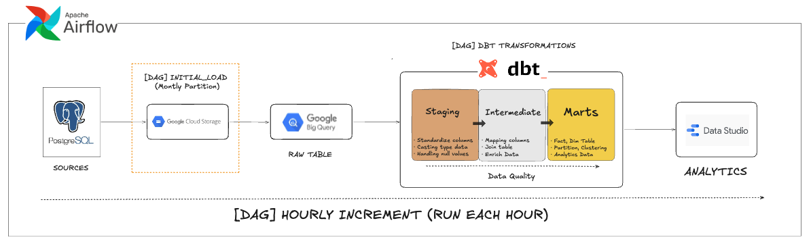
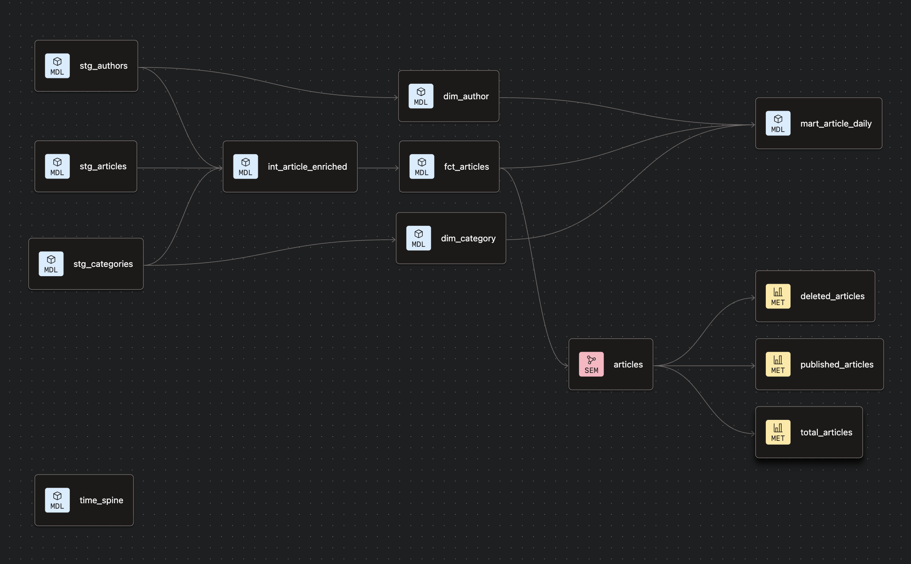
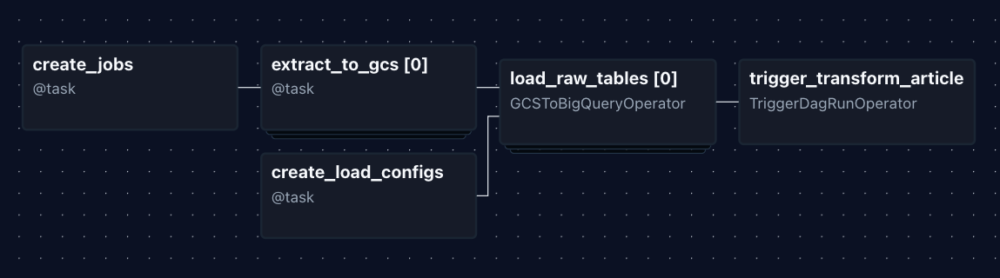
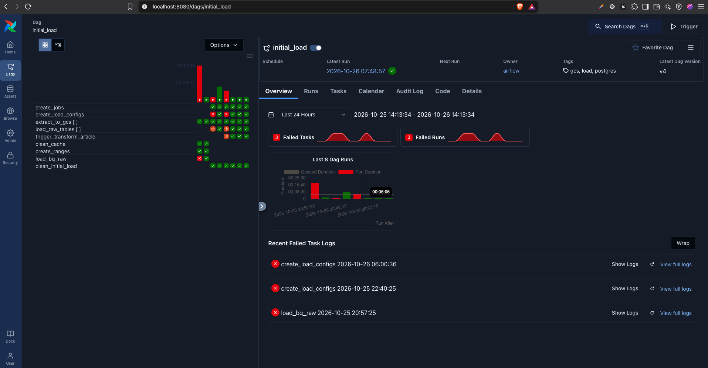
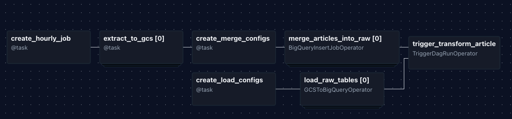
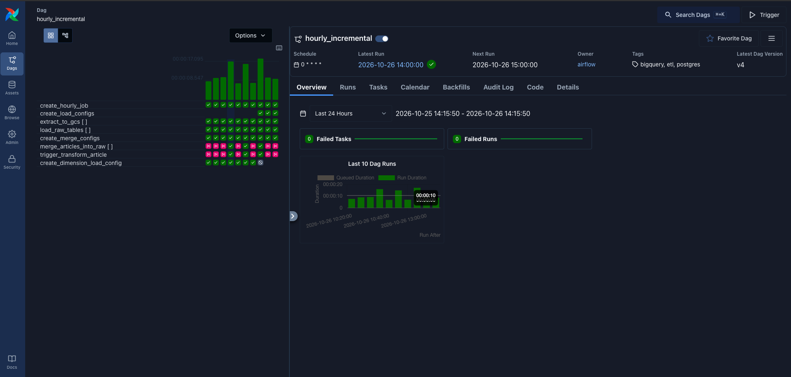
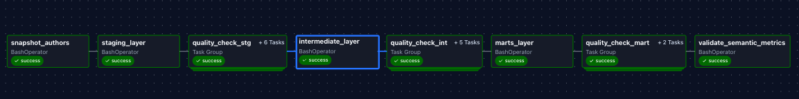
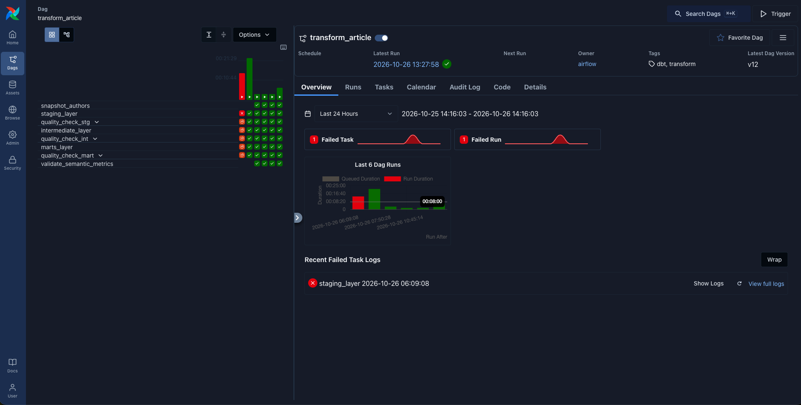
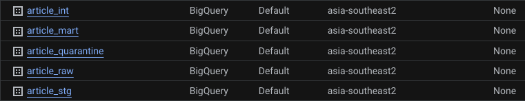

# Article ELT Pipeline

**An ELT pipeline that moves article data from PostgreSQL to a BigQuery data warehouse, with an initial backfill, hourly incremental updates, and dbt transformations up to analysis-ready marts and a semantic layer.**



---

## Table of Contents

- [Overview](#overview)
- [Task Requirements](#task-requirements)
- [Architecture](#architecture)
- [Tech Stack](#tech-stack)
- [Source Data & ERD](#source-data--erd)
- [Ingestion Strategy](#ingestion-strategy)
- [Airflow DAGs](#airflow-dags)
- [Data Modeling & Lineage](#data-modeling--lineage)
- [Folder Structure](#folder-structure)
- [Assumptions](#assumptions)
- [Setup](#setup)
- [How to Run](#how-to-run)
- [Design Considerations](#design-considerations)
- [Expected Output](#expected-output)

---

## Overview

This project implements an **ELT** pipeline for an article database (articles, authors, categories). Data is **extracted** from PostgreSQL, **loaded** as Parquet files into Google Cloud Storage (data lake) and then into BigQuery (raw layer), and **transformed** inside the warehouse with dbt into staging, intermediate, and mart layers.

Key features:

- **Initial load**: backfills the full history (2016 to 2026), chunked by month.
- **Hourly incremental load**: picks up only rows whose `updated_at` changed, and skips the transformation entirely when nothing changed.
- **Incremental dbt models** for `int_article_enriched` and `fct_articles`.
- **dbt snapshot** to keep the history of author email changes.
- **dbt Semantic Layer** with metrics defined on top of articles.
- **BigQuery table partitioning** on the article tables.

Everything is orchestrated by **Apache Airflow** and runs in Docker.

## Task Requirements

1. Create an ETL/ELT from a database (SQL or NoSQL) to a data warehouse.
2. The ELT must run every hour, every day.
3. Answer the design questions in [Design Considerations](#design-considerations).

## Architecture

```
                         ┌────────────────────────── Airflow ──────────────────────────┐
                         │                                                              │
  [DAG] initial_load (manual, once)            [DAG] hourly_incremental (every hour)
  all data 2016-2026, chunked monthly          changes in updated_at, 1-hour window
                         │                                       │
                         ▼                                       ▼
   PostgreSQL ──extract──▶ GCS (Parquet) ──load──▶ BigQuery RAW
   (articles, authors,                              raw_articles
    categories)                                     raw_authors
                                                    raw_categories
                         │                                       │
                         └────────── triggers (if changes) ──────┘
                                              │
                                              ▼
                              [DAG] transform_article (dbt)
                          staging ─▶ snapshot ─▶ intermediate ─▶ marts
                                              │
                                              ▼
                                  semantic layer / metrics
```

**Flow explanation:**

1. **Extract**: Airflow reads from PostgreSQL. Articles are read per time window (by `updated_at`); authors and categories are small, so they are read in full.
2. **Load to lake**: Data is written to GCS as Parquet with explicit column types, so every file has the same schema.
3. **Load to warehouse**: Files are loaded into BigQuery raw tables. Initial load rebuilds them; hourly upserts changed rows.
4. **Transform**: dbt builds `stg`, `int`, and `marts` from the raw tables.
5. **Serve**: The marts and the semantic layer expose metrics for analysis and BI tools.

## Tech Stack

`PostgreSQL` · `Google Cloud Storage` · `BigQuery` · `dbt` · `Apache Airflow` · `Docker` · `Pandas / PyArrow` · `SQL` · `Python`

## Source Data & ERD

The source database holds articles from **2016 to 2026**.


| Table | Main columns | Notes |
|---|---|---|
| `articles` | `id` (uuid), `title`, `content`, `status` (enum: DRAFT / PUBLISHED / ARCHIVED), `author_id`, `category_id`, `published_at`, `created_at`, `updated_at`, `deleted_at` | Soft delete via `deleted_at`. Watermark column: `updated_at` |
| `authors` | `id` (uuid), `name`, `email`, `created_at` | Small dimension, loaded in full |
| `categories` | `id` (integer), `name` | Small dimension, loaded in full |

## Ingestion Strategy

| Aspect | Initial load | Hourly incremental |
|---|---|---|
| Trigger | Manual (`schedule=None`) | Every hour (`0 * * * *`) |
| `articles` scope | All rows, one extract job per month | Rows with `updated_at` inside a 1-hour window (+5 min overlap) |
| `authors`, `categories` | Full snapshot | Full snapshot (small tables) |
| GCS path | `initial_load/<table>/<YYYY-MM>.parquet` | `initial_load/articles/hourly_<YYYY-MM-DD_HH>.parquet` |
| BigQuery raw load | `WRITE_TRUNCATE` (rebuilds tables) | Articles: upsert via `raw_articles_batch`; dimensions: `WRITE_TRUNCATE` |
| dbt trigger | Always, after load | Only if at least one article changed |

Why the hourly run is an **upsert** and not an append: `raw_articles` is kept as a mirror of the current state (one row per `id`). The hourly batch is loaded into `raw_articles_batch`, then in one transaction the matching ids are deleted from `raw_articles` and the new versions are inserted. Re-running the same hour gives the same result (idempotent).

## Airflow DAGs

Three DAGs, all in `airflow/dags/`:

### 1. `initial_load` (no schedule)

Loads the whole database into the warehouse. Run it once, before the hourly DAG.

```
clean_initial_load ─▶ create_jobs ─▶ extract_to_gcs (mapped, max 4 parallel)
                                          │
                                          ▼
                                   load_bq_raw ─▶ trigger transform_article
```

- Articles are split into one job per month, so a failed month can be retried alone.
- Authors and categories are single snapshot jobs.
- Records the start time in the Airflow Variable `initial_load_started_at`, which is used to align the hourly DAG.

### 2. `transform_article` (triggered, no schedule)

Runs dbt on the raw tables. It is triggered by `initial_load` and `hourly_incremental`.

```
install_dbt_packages ─▶ staging_layer ─▶ intermediate_layer ─▶ marts_layer ─▶ semantic metrics
```

- Each layer runs with `dbt build --indirect-selection buildable`, so tests that depend on a layer that is not built yet are skipped.
- Accepts `trigger_source` (`INITIAL_LOAD` or `HOURLY`) in the DAG run conf.

### 3. `hourly_incremental` (`0 * * * *`)

```
create_hourly_job ─▶ extract_to_gcs (mapped) ─┬─▶ load authors, categories (snapshot)
                                              └─▶ merge_articles_into_raw (upsert)
                                                          │
                        [merge, load dimensions] ─────────┴─▶ trigger transform_article
```

- Window: `[data_interval_start - 5 min, data_interval_end)`. The 5-minute overlap catches late commits; the upsert makes duplicates harmless.
- If no article changed in the window, `merge_articles_into_raw` has no work (skipped), and so does the dbt trigger.
- `catchup=True` with `start_date` set to the hour the initial load started, so no changes are missed between the two DAGs.

## Data Modeling & Lineage



dbt project: `dbt_article/`

| Layer | Models | Materialization |
|---|---|---|
| **staging** | `stg_articles`, `stg_authors`, `stg_categories` | table (`stg_articles` partitioned by `created_at`) |
| **snapshot** | author snapshot (tracks `email` changes) | dbt snapshot, `check` strategy on `email` |
| **intermediate** | `int_article_enriched` (articles + author + category + business flags) | **incremental** (`merge` on `article_id`), partitioned by `created_date` |
| **marts** | `fct_articles`, `dim_author`, `dim_category` | `fct_articles` **incremental**, partitioned by `created_date`; dimensions as tables |
| **semantic layer** | semantic model on `fct_articles` + metrics | dbt Semantic Layer |

Implemented requirements:

- **Incremental strategy**: `int_article_enriched` and `fct_articles` use `merge` with `unique_key = article_id`. A normal run reprocesses articles with `updated_at` from 1 day before the latest processed value. A manual backfill for one day is possible with `--vars '{"article_date": "YYYY-MM-DD"}'`.
- **Snapshot**: the author snapshot keeps every version of an author's email with `dbt_valid_from` / `dbt_valid_to`, so email changes are not overwritten.
- **Semantic layer**: metrics such as total articles, published articles, and average hours to publish are defined once on top of `fct_articles` and can be queried by dimensions like author, category, and date.
- **Partitioning**: article tables are partitioned by date, so queries filtering on date scan only the needed partitions, which matters for 10 years of data.
- **Data tests**: `not_null`, `unique`, `accepted_values`, `relationships`, and `dbt_utils.expression_is_true` checks on every layer.

## Folder Structure

```
.
├── airflow/
│   ├── dags/
│   │   ├── initial_load.py
│   │   ├── hourly_incremental.py
│   │   └── transform_article.py
│   └── include/
│       ├── constant.py            # table configs, dataset names, paths
│       ├── tasks/                 # reusable helpers: postgres, gcs, bigquery, dbt
│       └── usecases/              # initial_load and hourly_incremental workflows
├── dbt_article/
│   ├── models/
│   │   ├── staging/
│   │   ├── intermediate/
│   │   └── marts/
│   ├── snapshots/
│   └── dbt_project.yml
├── src/
│   └── seed.py                    # seeder that generates article data in PostgreSQL
├── docs/                          # erd, dag, lineage screenshots
├── docker-compose.yml
├── .env.example
├── requirements.txt
└── README.md
```

## Assumptions

- Authentication to Google Cloud uses **Application Default Credentials** (`gcloud auth application-default login`). No service account key is stored in the repo.
- All required Google Cloud services are enabled: Cloud Storage and BigQuery.
- The article database **already exists in PostgreSQL** and contains data from **2016 to 2026**. The seeder is provided only to create sample data when you do not have one.
- `updated_at` is set on every insert and update, including soft deletes (`deleted_at`), and is stored in **UTC**.
- Rows are never physically deleted (soft delete). See [question 2](#2-what-if-the-table-design-uses-hard-delete) for what changes otherwise.

## Setup

### 1. Clone and create the virtual environment

```bash
git clone <your-repo-url>
cd <your-repo>

python -m venv .venv
source .venv/bin/activate
pip install -r requirements.txt
```

### 2. Configure environment

```bash
cp .env.example .env
```

Fill in `.env` with your values (GCP project ID, bucket name, BigQuery dataset names, database credentials).

Authenticate to Google Cloud:

```bash
gcloud auth application-default login
```

### 3. Start services

```bash
docker compose up -d airflow-init   # one-time Airflow metadata DB init
docker compose up -d                # start Postgres, Airflow, and the other services
```

### 4. Seed the source database

Skip this step if the database is already filled. Adjust the numbers and dates to your needs:

```bash
python -m src.seed \
    --articles 1000 \
    --authors 50 \
    --start-date 2016-01-01 \
    --end-date 2016-12-31
```

## How to Run

1. Open Airflow at **http://localhost:8080** | **http://article.airflow.local** if you are using OrbStack .
2. Add a connection named **`google_cloud_default`** (Google Cloud Platform type). The PostgreSQL connection **`article_postgres`** is already defined inside the container.
3. Unpause **`transform_article`** first, so the runs triggered by the other DAGs are not left waiting.
4. Unpause and trigger **`initial_load`** to load the whole database into the data warehouse. When it finishes, it triggers `transform_article`.
5. Check the Airflow Variable `initial_load_started_at`, and make sure the `start_date` of `hourly_incremental` is set to the hour of that value.
6. Unpause **`hourly_incremental`**. It runs every hour and triggers `transform_article` only when articles changed.

## Design Considerations

### 1. The ELT is new, and the data in the database is from 2016. What should you consider?

The first run is not a normal run: it has to bring 10 years of history in safely, and then hand over to the hourly job without losing or duplicating anything.

- **Separate the backfill from the recurring job.** A dedicated `initial_load` DAG handles history; `hourly_incremental` only handles changes. Mixing both in one DAG makes it full of "first run or not" branches.
- **Do not read everything in one query.** The history is split by month: each chunk is small, can be retried alone, and does not hold a long transaction on the source database. Parallelism is capped (4 tasks at a time) to protect the production database.
- **Idempotency.** File paths are deterministic and the raw load uses `WRITE_TRUNCATE`, so a failed or repeated initial load never creates duplicates. The hourly upsert is idempotent for the same reason.
- **Old rows can change.** An article created in 2018 can be edited today, so the watermark is `updated_at`, not `created_at`. Downstream dbt models therefore reprocess by `updated_at` and are partitioned by date, so reprocessing touches only the affected partitions. Late commits are covered by the 10-minute overlap.

### 2. What if the table design uses hard delete?

With hard delete, the row disappears from PostgreSQL completely, so a watermark on `updated_at` **cannot see it**: there is no row left to read, and the warehouse would keep the deleted record forever.

This project's source uses **soft delete** (`deleted_at`), which the pipeline already handles: the delete updates `updated_at`, the hourly job picks the row up, and `is_deleted` is derived in `int_article_enriched`. If the table were hard delete, the options are, from best to simplest:

| Option | How it works | Trade-off |
|---|---|---|
| **1. Switch to soft delete** | The application sets `deleted_at` and `updated_at` instead of removing the row | Best fix, but needs a change on the source system |
| **2. Delete log (tombstone) table** | A PostgreSQL trigger writes `(id, deleted_at)` into a `deleted_articles` table on every `DELETE`. The hourly DAG reads it by `deleted_at` and removes those ids from `raw_articles` | Small, near real-time, low load. Needs a trigger on the source |
| **3. CDC (log-based)** | Read delete events from the PostgreSQL WAL (for example Datastream or Debezium) and apply them in BigQuery | Most complete and low latency, but more infrastructure |

> [!IMPORTANT]
> **Scope note:** this project implements **soft delete handling only** (`deleted_at`, captured through `updated_at`).
> It does **not** solve the hard delete scenario, where the row is physically removed from PostgreSQL and the
> watermark-based pipeline can no longer see it.

### Future solution: Change Data Capture (CDC) with Debezium

If I have more time to answer, I would replace the polling approach for deletes with log-based CDC.

## AI Usage

> [!NOTE]
> **Traditional prompting, not an AI agent.** I used AI (Claude) through a chat interface, prompt and response.
> I did not use an autonomous coding agent. The AI had no access to my repository, terminal, database, or
> cloud account. I copied the output into my own project manually, ran everything myself, and fed the errors
> back as new prompts.

I used AI assistance as a pair-programming and learning tool during this project. The design decisions, debugging, and final code were reviewed and tested by me.

| Area | How AI was used |
|---|---|
| **Brainstorming & idea exploration** | Explored how the hourly schedule maps to data windows, how the initial load should hand over to the incremental load, and how to handle late-arriving data |
| **Comparing approaches** | Compared options such as `MERGE` vs delete+insert upserts, window-based vs state-based watermarks, dbt snapshot vs incremental models, and CDC vs polling for hard deletes |
| **Infrastructure & architecture design** | Discussed the GCS landing zone, the raw/staging/intermediate/marts layers, and how the three DAGs trigger each other |
| **Initial code generation** | Drafted the first version of the Airflow DAGs (initial load, hourly incremental, dbt transformation), which I then adapted into my own project structure |
| **dbt** | Drafted data tests (`not_null`, `unique`, `relationships`, `expression_is_true`) and helped diagnose test selection issues between layers |
| **Docker setup** | Helped with the container setup for Airflow and PostgreSQL |
| **Documentation** | Helped structure and write this README and the answers to the design questions |

**What I did myself:** ran every DAG end to end, debugged the errors that came up (for example the Parquet type mismatch between files, and dbt tests running before their models existed), copied, integrated, and tested all generated code manually, adapted it to my own project structure, and verified the results in BigQuery.

## Expected Output

### DAGs
#### Initial Load DAG



#### Hourly Increment DAG



#### dbt Transformation
 


### dbt Lineage


### BigQuery


---